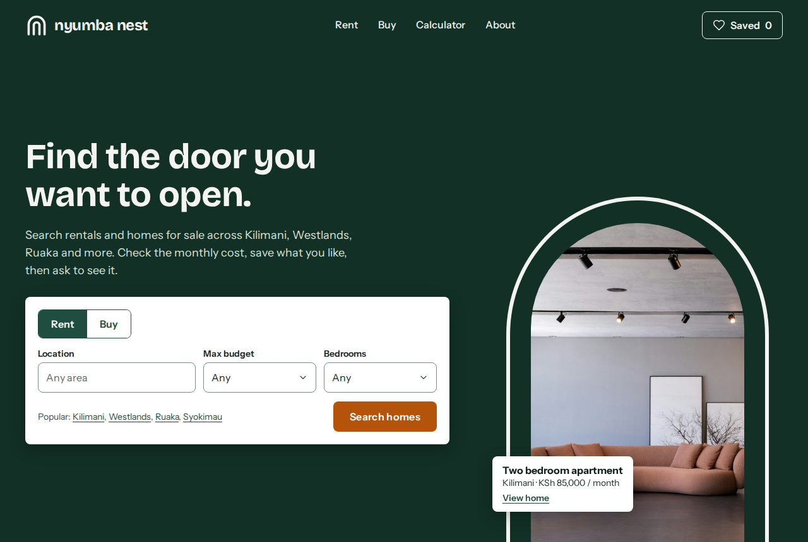
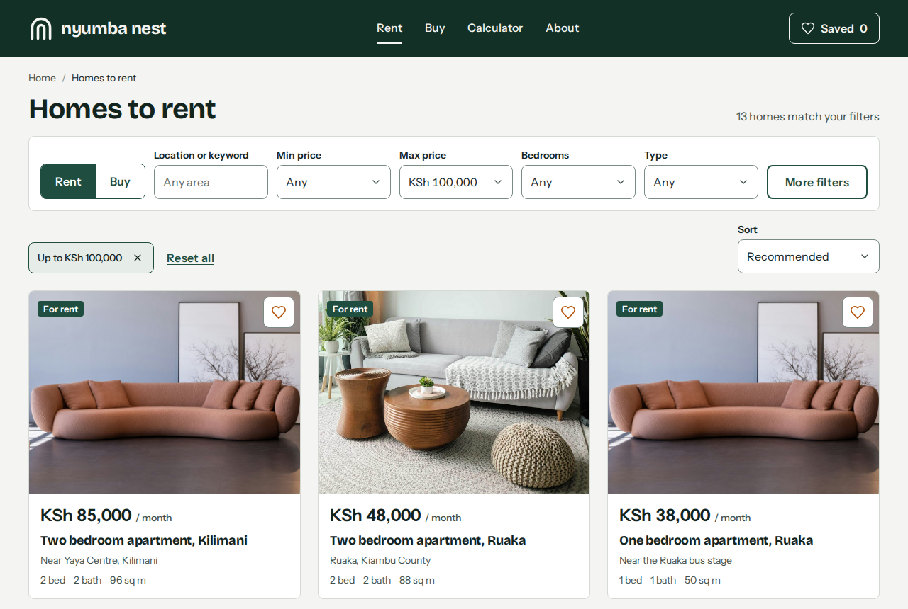
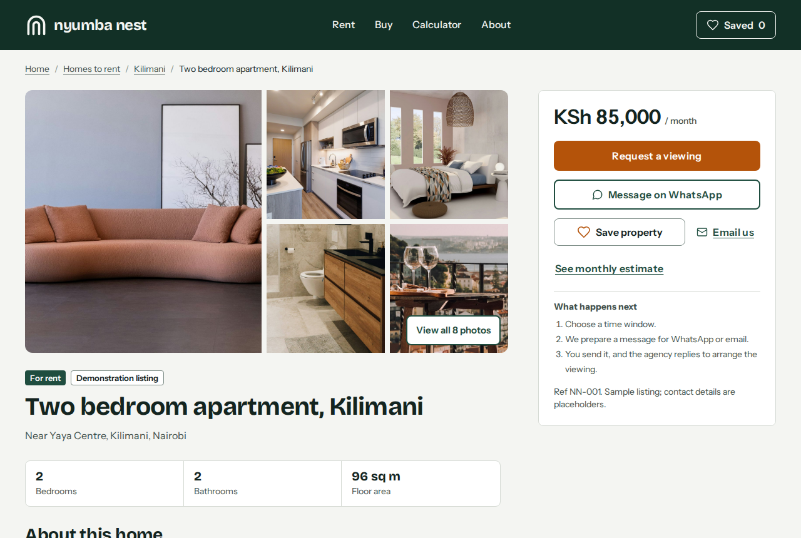
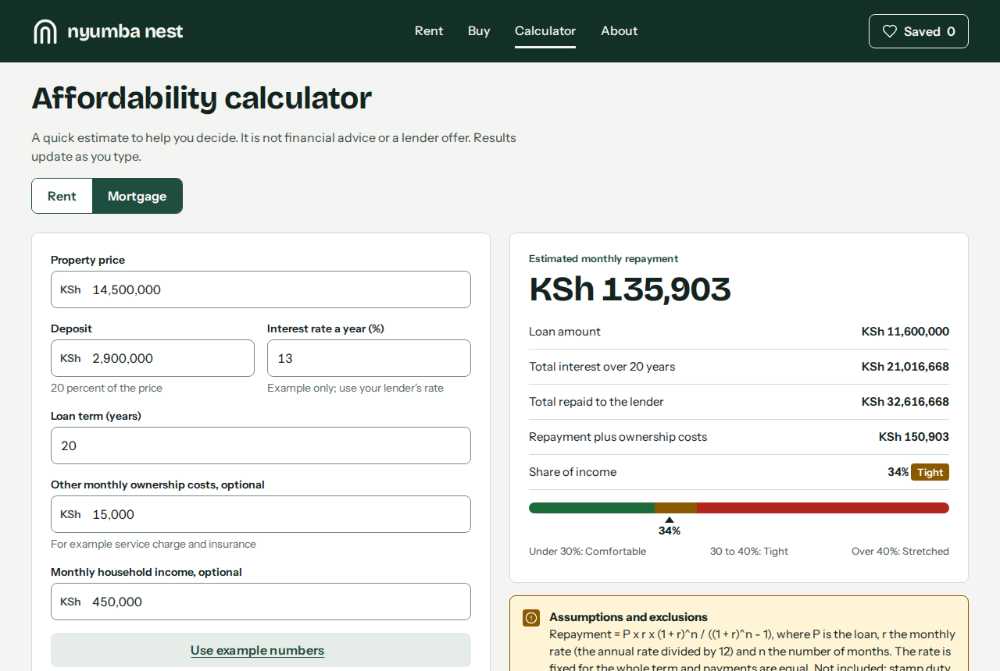
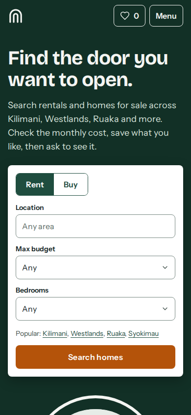
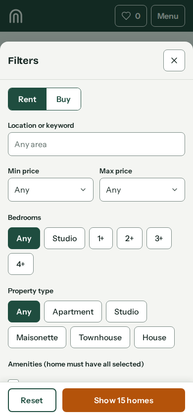
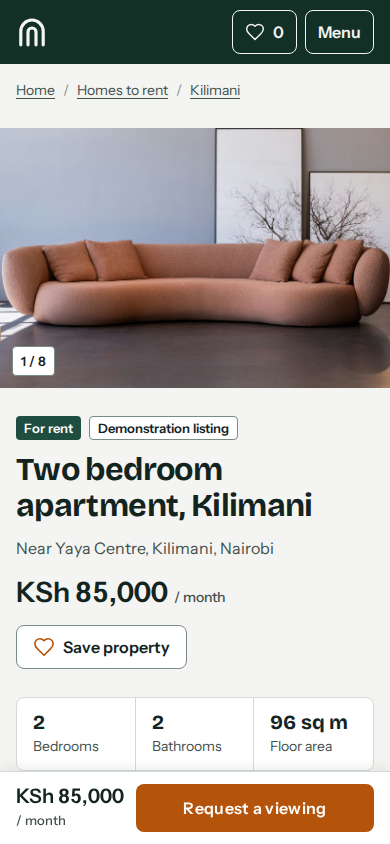

# Nyumba Nest

A property discovery and viewing-enquiry frontend for a fictional Nairobi estate agency. Visitors can search rentals and homes for sale, narrow results with filters, save a shortlist, check affordability, and prepare a viewing request that opens a ready-written WhatsApp message or email.

> **Demonstration project.** Nyumba Nest is a fictional agency. All listings, the phone number and the email address are sample content. Property photographs are replaceable placeholder images.



## Features

- **Search and filters.** Rent or buy, location or keyword, min and max price, bedrooms, property type and amenities. Every filter lives in the URL, so results survive refresh, Back and sharing.
- **Sorting and pagination.** Recommended, price (both ways) and newest, with a "Load more" pattern and a live result count.
- **Active filter chips.** Each filter can be removed on its own, or all can be reset. An empty result lists the filters causing it and suggests a higher maximum price when that would help.
- **Mobile filter sheet.** A bottom sheet on phones and a side drawer on tablets, with a live "Show 14 homes" count on the apply button.
- **Property pages.** Photo mosaic on larger screens, swipeable rail on phones, a keyboard-operable full-screen viewer, amenities, terms, a map that loads only on request, similar homes and a sticky enquiry panel or bar.
- **Shortlist.** Save from any card or detail page. Stored in `localStorage`, synced across tabs, with Undo, a confirm step for "Clear all" and a notice when a saved home is no longer listed.
- **Affordability calculators.** Rent against income, and a mortgage estimate using the standard repayment formula. Assumptions and exclusions are shown beside the result, and invalid input shows messages instead of numbers.
- **Viewing requests without a backend.** Validated form that prepares a WhatsApp message or an email draft. The site never claims a viewing is booked; it tells the visitor the agency only receives the message once they send it, and offers a copy fallback if the app does not open.
- **Accessibility.** Semantic landmarks, skip link, native `<dialog>` for focus trapping, visible focus rings, labelled controls, error summaries that take focus, live regions, and reduced-motion support.
- **SEO basics.** Per-route titles and meta descriptions, one `h1` per page, descriptive image alt text and Open Graph tags.

## Screenshots

| Listings | Property page | Calculator |
| --- | --- | --- |
|  |  |  |

| Home (mobile) | Filters (mobile) | Property (mobile) |
| --- | --- | --- |
|  |  |  |

## Tech stack

- React 19 and React Router 7
- Vite 8
- Plain CSS with design tokens (CSS custom properties), no UI framework
- `@fontsource-variable` for self-hosted Bricolage Grotesque and Instrument Sans
- Vitest for unit tests of the filtering, calculator and contact logic, and ESLint with the React Hooks rules
- GitHub Actions workflow that lints, tests and builds on every push

There are no other runtime dependencies.

## Getting started

Requirements: Node.js 20 or newer.

```bash
npm install
npm run dev        # start the dev server
npm run build      # production build in dist/
npm run preview    # serve the production build locally
npm test           # run unit tests
npm run lint       # run ESLint
npm run images     # re-assign listing photos from public/images/listings/
```

### Configuration

Agency details live in one file, `src/config.js`. Replace the placeholder WhatsApp number and email before deploying:

```js
export const agency = {
  whatsappNumber: '254700000000', // digits only, with country code
  displayPhone: '+254 700 000 000',
  email: 'hello@nyumbanest.example',
}
```

### Replacing placeholder photographs

1. Download photos (for example from Unsplash) and export them as 4:3 JPEGs about 1600 by 1200 px, under 250 KB each.
2. Save them in `public/images/listings/` named `<kind>-<number>.jpg`, for example `living-1.jpg`, `living-2.jpg`, `kitchen-1.jpg`. Kinds: living, kitchen, bedroom, bathroom, exterior, balcony, garden, view, pool. Add `-apt-` or `-house-` for outdoor kinds if you want them matched to the property type.
3. Run `npm run images`. It points every listing image at your photos, spreading them so neighbouring listings differ. Kinds with no photos keep their placeholder.
4. For the home page arch photo, change the `src` in `src/pages/Home.jsx` to one of your files, for example `images/listings/living-1.jpg`.
5. Record each photographer in `docs/IMAGE_CREDITS.md`.

Cards use a 4:3 crop and the gallery a 3:2 crop. The wrapper owns the aspect ratio, so any photo size works without layout changes.

### Deployment

**Vercel (recommended).** Push the repository to GitHub, then in Vercel choose "Add New Project", import the repository and accept the detected Vite settings (build command `npm run build`, output directory `dist`). `vercel.json` rewrites every path to `index.html`, so deep links such as `/properties/two-bedroom-apartment-kilimani` work after a refresh. No environment variables are needed.

**Other hosts.** Any static host works if it serves `index.html` for unknown paths. On Netlify add a `public/_redirects` file containing `/*  /index.html  200`. On GitHub Pages copy `index.html` to `404.html` after building and set `base` in `vite.config.js` to your repository name.

Before going live, replace the placeholder WhatsApp number and email in `src/config.js`, and consider adding an `og:image` (it needs an absolute URL, so it can only be set once you know your domain).

## Project structure

```
public/
  data/properties.json       Listing data (single source of truth)
  images/placeholders/       Replaceable placeholder images
src/
  components/                Reusable UI: cards, filters, gallery, forms, dialogs
  context/                   Properties loader, saved shortlist, toasts
  hooks/                     Document title and meta description
  lib/                       Pure logic: filters, calculators, contact helpers, formatting
  pages/                     One component per route
  styles/                    tokens.css, base.css, layout.css, components.css, pages.css
tests/                       Unit tests for src/lib
docs/screenshots/            README images
```

## Key implementation decisions

- **The URL is the filter state.** `useSearchParams` holds type, keyword, prices, bedrooms, property type, amenities, sort and page. There is no duplicate state to keep in sync, and Back, refresh and shared links just work.
- **One filter component set, two layouts.** The desktop bar, the tablet row and the mobile sheet reuse the same field components. The sheet edits a draft and applies it with a live count, while the desktop bar applies instantly.
- **Native `<dialog>`.** The menu, filter sheet, photo viewer and confirmation use the platform element for focus trapping, Escape handling and an inert background, wrapped in one small component.
- **Honest enquiries.** With no backend, the viewing form builds a message and hands it to WhatsApp (`wa.me`) or `mailto:`. The success screen says the message is ready, not sent, and a failure screen offers copy and web fallbacks.
- **Private by default.** The map is loaded only when the visitor asks, so no third party is contacted on page load, and it needs no API key. Viewing details are never stored.
- **Pure, tested logic.** Filtering, the repayment formula, phone normalisation and message building are plain functions in `src/lib`, covered by unit tests, including the worked mortgage example (KSh 11,600,000 at 13 percent over 20 years is KSh 135,903 a month).
- **Design tokens.** Colour, type, space, radius, shadow and motion values come from `tokens.css`, which matches the design system the interface was designed against.
- **Motion with restraint.** One entrance moment on the home hero, small transitions on hover, dialogs and toasts, and a global reduced-motion override.

## What I learned

- Treating the URL as the single source of truth for filters removed a whole class of state bugs, and made Back and shared links work for free.
- Native `<dialog>` handles most of the hard accessibility work for overlays, but it still needs care around focus return, body scroll locking and backdrop clicks.
- A flex or grid container that scrolls can collapse children with `overflow: hidden`. A segmented control inside a scrolling filter sheet disappeared until I stopped its children shrinking.
- `window.open` with `noopener` always returns `null`, so detecting a blocked popup needs a plain `window.open` and then clearing `opener` manually.
- Writing honest copy for a form with no backend is a design problem as much as an engineering one. "Your message is ready" and "we only receive it once you send it" took more thought than the validation did.
- Testing in a real browser at phone, tablet and desktop sizes found issues that looked fine in the design, such as breadcrumbs wrapping onto two large tap targets above the gallery on small phones.

## Limitations and next steps

- Photographs and listings are placeholders; no real inventory or backend exists.
- Accessibility was audited with axe-core (WCAG 2.2 AA rules) on every route and on the filter sheet, menu, photo viewer and form error states, with no remaining violations. Automated checks do not replace testing with a screen reader.
- The layout was checked at 320, 390, 768, 1024, 1280, 1440 and 1920 px in a headless browser, but not on physical devices.
- Future ideas: a real booking service, saved searches, side-by-side comparison, area pages and Swahili copy.
